# E-Commerce Sales Analysis (MySQL)

## Overview
SQL project analyzing sales data of a fictional e-commerce store.
It covers revenue trends, product performance, and customer behavior.

## Tools Used
- MySQL 8.0
- MySQL Workbench

## Database Schema
4 tables: customers, products, orders, order_items

## SQL Concepts Used
JOINs, GROUP BY, HAVING, CTEs, Window Functions (RANK, LAG),
CASE statements, Views, Aggregate functions

## Business Questions Answered

|  | Business Question | SQL Concepts Used |
|---|-------------------|-------------------|
| Q1 | What are the total revenue, total orders, and average order value? | Aggregate functions, View |
| Q2 | How does revenue change month by month? | GROUP BY, DATE_FORMAT |
| Q3 | Which product category earns the most revenue and sells the most units? | JOIN (via view), GROUP BY |
| Q4 | Which are the top 3 products by revenue? | GROUP BY, ORDER BY, LIMIT |
| Q5 | Which cities generate the most orders and revenue? | GROUP BY, COUNT DISTINCT |
| Q6 | Which customers are repeat buyers (2 or more delivered orders)? | GROUP BY, HAVING |
| Q7 | Which customers have registered but never placed an order? | LEFT JOIN, IS NULL |
| Q8 | What share of orders and order value is Delivered, Cancelled, or Returned? | JOIN, subquery, percentage calculation |
| Q9 | How can customers be segmented into High, Medium, and Low value based on total spend? | CTE, CASE |
| Q10 | What is the best-selling product in each category? | CTE, RANK() window function |
| Q11 | How much did revenue grow or shrink compared to the previous month? | CTE, LAG() window function |
| Q12 | What is the cumulative (running) revenue over time? | CTE, SUM() OVER |

## Key Insights

*Based on Delivered orders only (cancelled and returned orders are excluded from revenue).*

### Overall performance
- The store generated **₹47,460** in revenue from **17 delivered orders**, with an average order value of **₹2,791.76** (Q1).
- Cancelled and returned orders (3 of 20) were worth **₹8,497** in lost revenue, about **15%** of total order value (Q8).
- **85%** of orders were delivered, **10%** cancelled, **5%** returned (Q8).

### Revenue trends
- **September 2025** was the best month (₹10,090), up **80%** from August (Q2, Q11).
- **November 2025** was the weakest month (₹4,094), a **42%** drop from October, partly because a ₹3,499 order was cancelled (Q2, Q11).
- Revenue rebounded strongly in **December** (₹7,796, +90% vs November), so the year ended on a high (Q11).
- Cumulative revenue crossed ₹28,000 by September, which is about 60% of the total (Q12).

### Products and categories
- **Electronics** is the top category with ₹23,489, about **49% of total revenue** (Q3).
- **Stationery** sells the most units (12) but earns the least revenue (₹3,588), because its items are low priced (Q3).
- The top 3 products are **Mechanical Keyboard** (₹10,497), **Bluetooth Headphones** (₹8,997), and **Running Shoes** (₹7,497) (Q4).
- Best seller per category: Keyboard (Electronics), Running Shoes (Fashion), Yoga Mat (Fitness), Notebook Pack (Stationery) (Q10).

### Customers and geography
- **Delhi** contributes **49%** of revenue (₹23,080) and 8 of 17 orders. **Bengaluru** is second (₹14,491). Chennai is the weakest city (₹799) (Q5).
- **6 of 10 customers** are repeat buyers with 2 or more delivered orders. The top buyer, Aarav Sharma, placed 4 orders worth ₹11,092 (Q6).
- **2 registered customers** (Rahul Nair and Pooja Joshi) have never placed an order, which makes them a target for a first-purchase offer (Q7).
- **5 High Value customers** generate about **87% of revenue**, which shows how dependent the business is on a small group of buyers (Q9).
## How to Run
1. Install MySQL 8.0+ and MySQL Workbench
2. Run the files in this order:
   1. `schema.sql` (creates the database and tables)
   2. `sample_data.sql` (inserts the sample data)
   3. `views.sql` (creates the reporting view)
3. Open `analysis_queries.sql` and run each query one at a time (Ctrl + Enter)

*Dataset: 20 sample orders created for this project (fictional data).*

## Screenshots
1. Query1
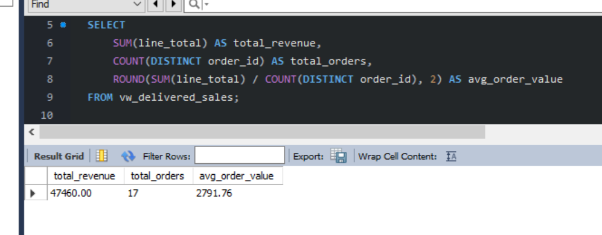 
2. Query2
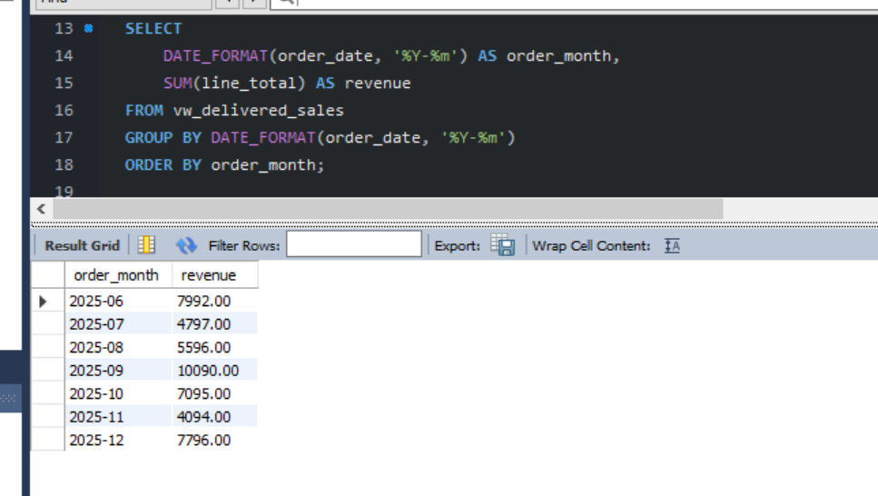 
3. Query3
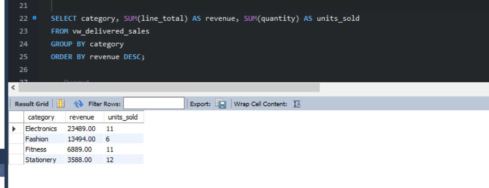 
4. Query4
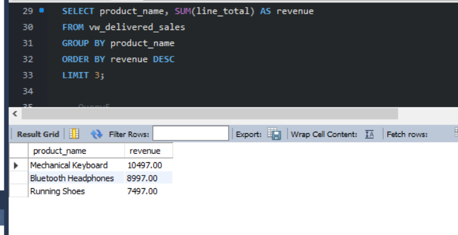 
5. Query5
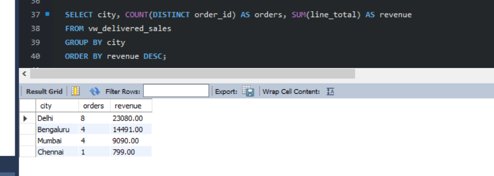 
6. Query6
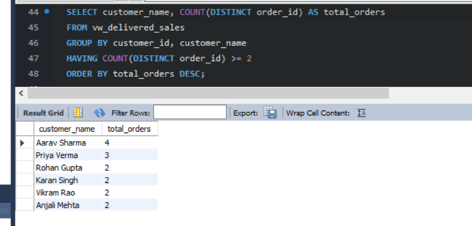 
7. Query7
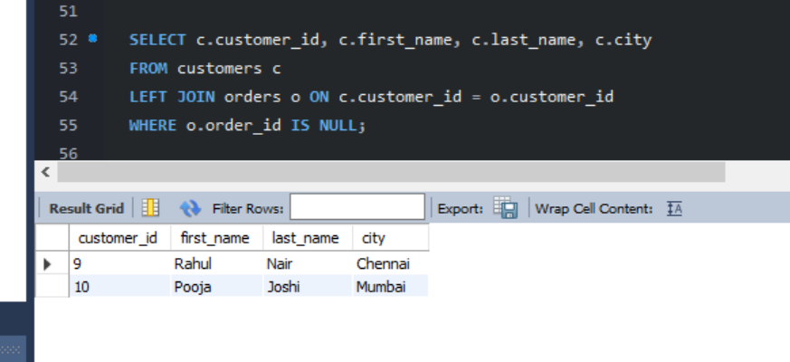 
8. Query8
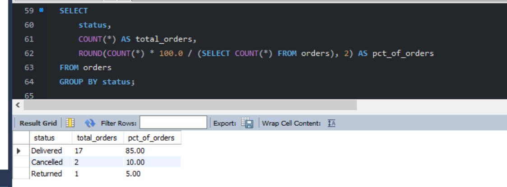 
9. Query9
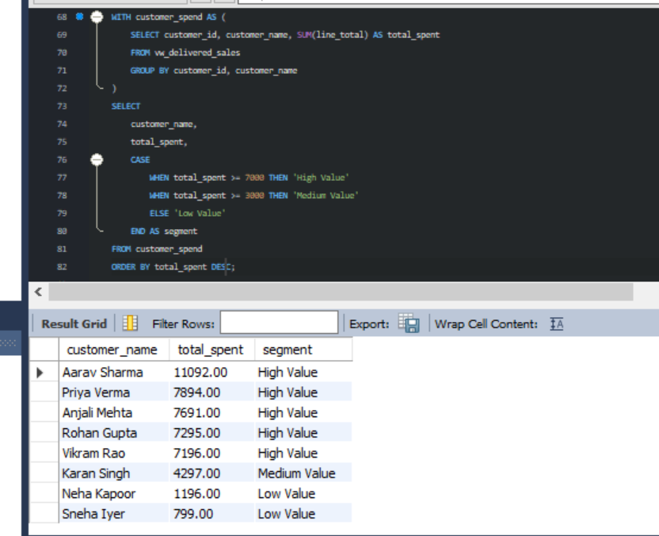 
10. Query10
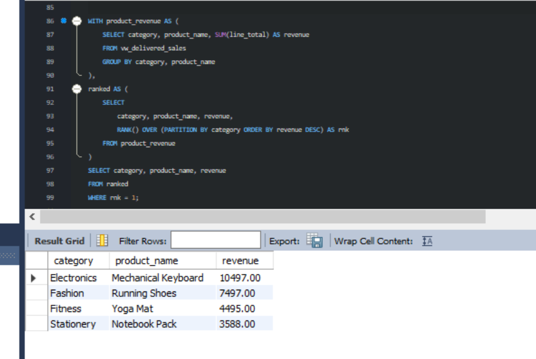 
11. Query11
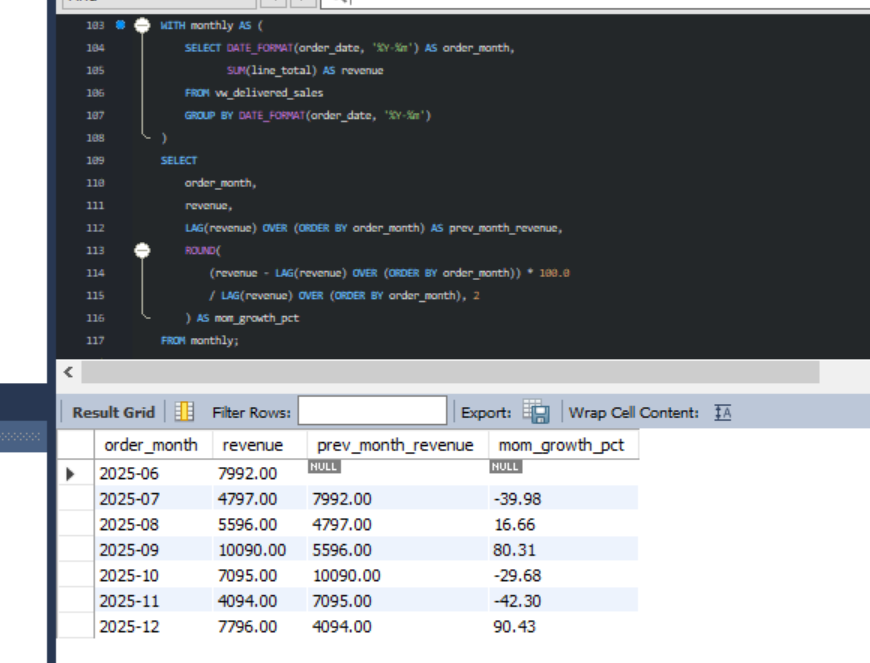
12. Query12
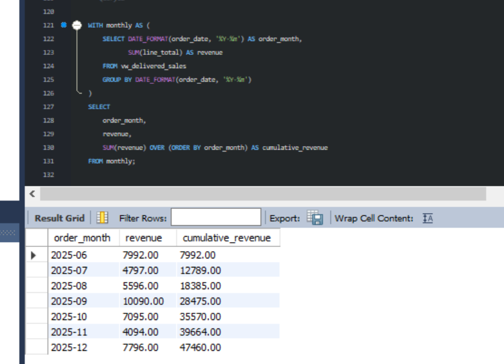
